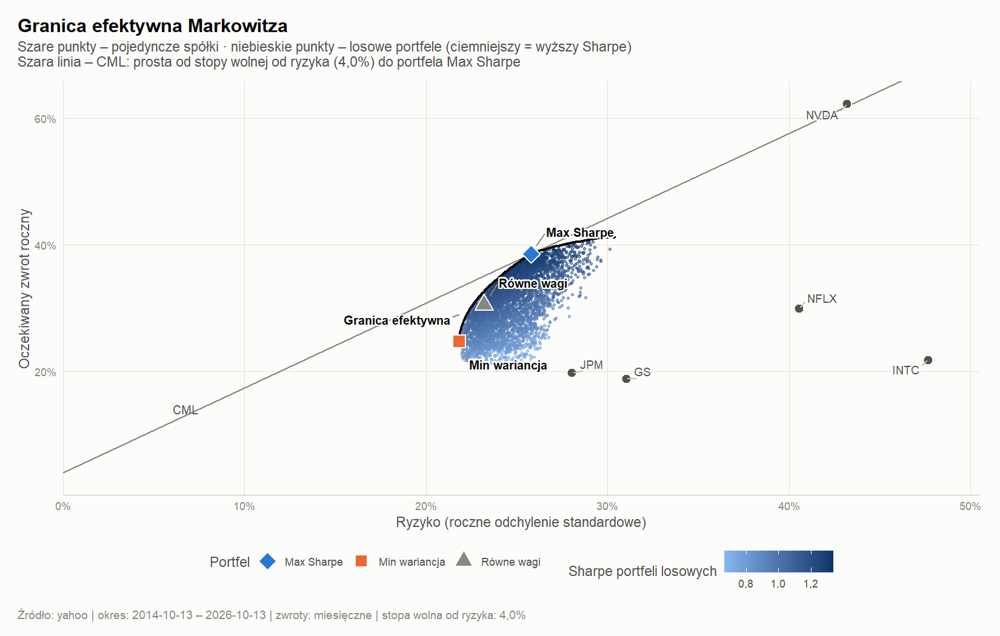
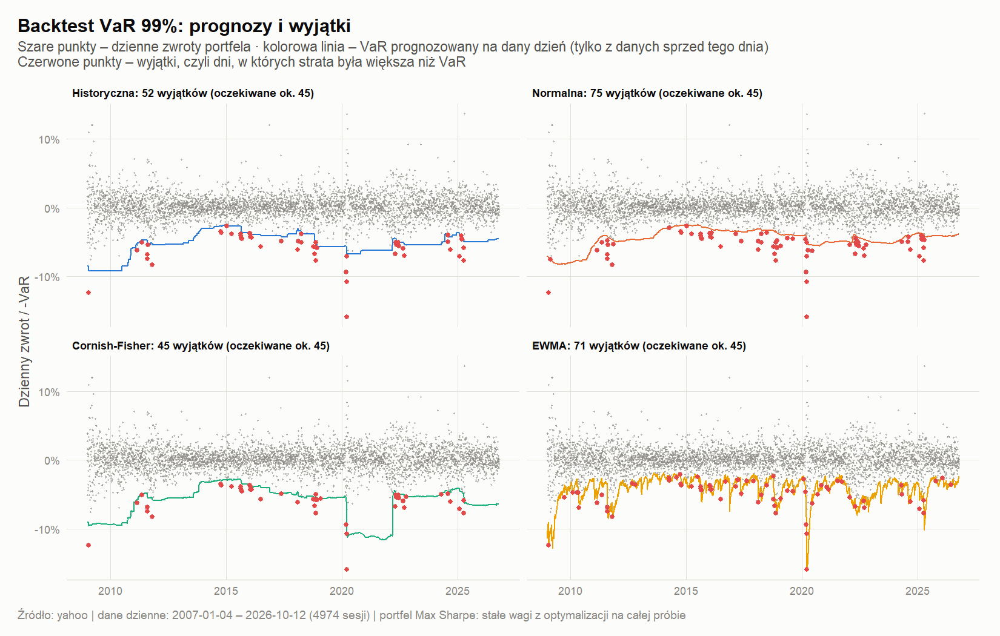
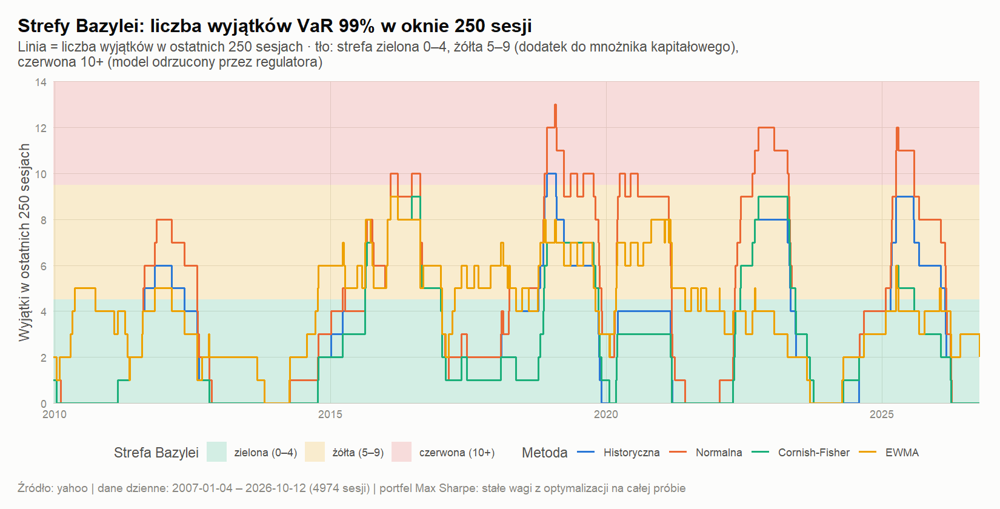
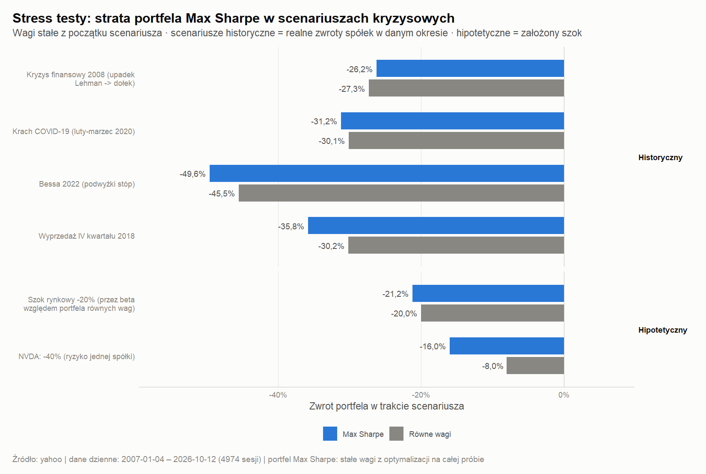

[README (1).md](https://github.com/user-attachments/files/33385288/README.1.md)
# Constrained Mean-Variance Optimisation and Market Risk Toolkit (R)

A single-file R pipeline that (1) builds optimal portfolios from a user-chosen set of stocks and (2) evaluates the market risk of the resulting portfolio the way a risk team would: VaR and Expected Shortfall, formal VaR backtesting, Basel traffic-light zones and stress tests.

The project started as a Markowitz optimiser and was extended with a market-risk module, so it covers both sides of the question: *what should I hold?* and *how much can I lose, and how do I know my risk model is any good?*

> Console output and chart labels are in Polish. Code identifiers are in English where they are not user-facing; settings are documented below.

---

## What it does

### 1. Portfolio construction
- Downloads adjusted prices from Yahoo Finance (or reads a CSV, or generates simulated data in `demo` mode).
- Estimates expected returns and the covariance matrix, optionally with **Ledoit-Wolf shrinkage** for a more stable covariance estimate.
- Solves for the **maximum-Sharpe** and **minimum-variance** portfolios and the full **efficient frontier** with a quadratic programme (`quadprog`), under weight constraints (default: long-only, max 40% per stock).
- Compares both with an equal-weight benchmark.

### 2. Out-of-sample backtest
- Rolling window (default 5 years of history, rebalanced every 12 months). Weights at each date use **only data available before that date**.
- Transaction costs on turnover (default 10 bp) and weight drift between rebalances.
- Reports CAGR, volatility, Sharpe ratio, maximum drawdown and final value.

### 3. Market-risk module (daily data)
Applied to the daily returns of a chosen portfolio (constant weights, default: the max-Sharpe portfolio).

| Component | Details |
|---|---|
| **VaR / ES** | Historical simulation, parametric normal, Cornish-Fisher (skewness and kurtosis adjusted), EWMA (RiskMetrics, λ = 0.94); 95% and 99%; 10-day VaR by square-root-of-time scaling; stressed VaR |
| **Distribution diagnostics** | Skewness, excess kurtosis, Jarque-Bera test, QQ plot |
| **VaR backtest** | Rolling out-of-sample forecasts (500-day window); each day's VaR uses only earlier data |
| **Statistical tests** | Kupiec proportion-of-failures test, Christoffersen independence test, joint conditional-coverage test; ratio of realised loss to forecast ES on exception days |
| **Basel traffic light** | Exceptions of 99% VaR in the last 250 sessions mapped to green / yellow / red zone with the capital multiplier add-on; rolling view over the whole sample |
| **Stress tests** | Historical windows: 2008 financial crisis, COVID-19 crash, 2022 bear market, Q4 2018 sell-off. Hypothetical: market shock (propagated through each stock's beta), single-name shock on the largest position |

---

## Quick start

Requires R ≥ 4.1. Missing packages (`quadprog`, `ggplot2`, `dplyr`, `tidyr`, `scales`, `ggrepel`, `quantmod`) are installed automatically on first run.

```bash
# Yahoo Finance data, default settings (edit TICKERS in the script)
Rscript markowitz_portfolio.R

# Offline, simulated data (to see how the outputs look)
Rscript markowitz_portfolio.R DATA_SOURCE=demo

# Override settings from the command line
Rscript markowitz_portfolio.R TICKERS=KO,PEP,MCD,NVDA MAX_WEIGHT=0.5
Rscript markowitz_portfolio.R "RISK_PORTFOLIO=Równe wagi" VAR_LEVELS=0.95,0.975,0.99

# Own prices: first column Date (YYYY-MM-DD), then one price column per ticker
Rscript markowitz_portfolio.R DATA_SOURCE=csv CSV_PATH=prices.csv
```

In RStudio: open the file and click **Source**; the plots appear in the Plots pane.

## Key settings (section 1 of the script)

| Setting | Default | Meaning |
|---|---|---|
| `TICKERS` | 5 stocks | Yahoo Finance symbols (Warsaw: `.WA` suffix) |
| `FREQUENCY` | `monthly` | Return frequency for the optimisation |
| `RISK_FREE_RATE` | 0.04 | Annual risk-free rate used for Sharpe ratios |
| `MIN_WEIGHT` / `MAX_WEIGHT` | 0 / 0.40 | Per-stock weight bounds (negative minimum allows shorts) |
| `COV_METHOD` | `shrinkage` | `shrinkage` (Ledoit-Wolf) or `sample` |
| `LOOKBACK_YEARS`, `REBALANCE_MONTHS`, `TRANSACTION_COST` | 5, 12, 0.001 | Backtest design |
| `RUN_RISK` | `TRUE` | Switch the risk module on or off |
| `RISK_PORTFOLIO` | `Max Sharpe` | Portfolio analysed by the risk module |
| `RISK_START_DATE` | `2007-01-01` | Start of daily history for the risk module (needed to cover 2008) |
| `VAR_LEVELS`, `VAR_WINDOW`, `EWMA_LAMBDA` | 0.95/0.99, 500, 0.94 | VaR confidence levels, estimation window, EWMA decay |
| `STRESS_MARKET_SHOCK`, `STRESS_NAME_SHOCK`, `STRESS_VOL_MULT` | −20%, −40%, 1.5 | Hypothetical stress parameters |

## Outputs (`output/`)

| File | Content |
|---|---|
| `01`–`06_*.png` | Prices, correlations, efficient frontier, weight transition map, portfolio weights, capital vs risk share |
| `07`–`09_*.png` | Backtest: wealth, drawdown, weights through time |
| `10_ryzyko_rozklad_zwrotow.png` | Return distribution with VaR / ES lines and normal curve |
| `11_ryzyko_qq.png` | QQ plot against the normal distribution |
| `12_ryzyko_backtest_var.png` | VaR forecasts, returns and exceptions by method |
| `13_ryzyko_strefy_bazylei.png` | Rolling 250-day exception count against Basel zones |
| `14_ryzyko_stress_testy.png` | Stress test losses |
| `*.csv` | All tables (semicolon-separated, decimal comma, UTF-8 BOM: opens correctly in Polish-locale Excel) |

## Example results

<!-- Fill in after running on real Yahoo Finance data: commit the PNGs to docs/ and write 2-3 sentences with your actual numbers
     (e.g. which VaR methods passed the Kupiec test, which Basel zone the portfolio is in, the worst stress scenario). -->






---

## Methodology notes

**Optimisation.** Minimise `wᵀΣw` subject to `Σw = 1`, `lo ≤ w ≤ hi` and (for frontier points) `wᵀμ = target`. The maximum-Sharpe portfolio is the tangency point on the constrained frontier, found by a grid over target returns and refined with a one-dimensional optimiser.

**Covariance.** Ledoit-Wolf shrinkage towards a scaled identity matrix (Ledoit and Wolf, 2004); the shrinkage intensity is printed on each run.

**VaR and ES** are reported as positive losses (fraction of portfolio value). Normal: `−(μ + z·σ)`. Cornish-Fisher replaces `z` with a skewness- and kurtosis-adjusted quantile. EWMA uses a zero-mean exponentially weighted variance. Historical ES is the average of returns at or below the historical VaR quantile.

**Backtest logic.** An *exception* is a day on which the realised loss exceeds that day's VaR forecast. Under a correct model, exceptions occur with probability `1 − confidence` and are independent. Kupiec tests the first property, Christoffersen the second; the joint test has a χ² distribution with 2 degrees of freedom. The ES ratio (average realised loss on exception days ÷ average forecast ES on those days) is a simple calibration diagnostic, not a formal ES backtest.

**Stress tests.** Historical scenarios apply the portfolio weights at the start of the window to the realised stock returns over the window (windows follow S&P 500 peaks and troughs; see `HIST_SCENARIOS`). A scenario is skipped automatically if the data do not cover the window. Stressed VaR scales every stock's volatility by `STRESS_VOL_MULT` and sets all correlations to 1, i.e. `σ_p = mult · Σ|wᵢ|σᵢ`.

## Validation

- Test statistics were checked against hand-computed values (for example, Kupiec LR = 1.957 for 5 exceptions in 250 days at 99%), and VaR / ES against the closed-form N(0,1) values (99% VaR ≈ 2.33, ES ≈ 2.67).
- The full pipeline was run end to end on simulated data with GARCH(1,1) volatility clustering and fat-tailed (Student-t) innovations. On such data the normal VaR is rejected by the Kupiec test and underestimates ES, while on normally distributed demo data no model is rejected, which is the expected behaviour of the tests.
- The implementation has **not** been cross-checked against a third-party library (for example `rugarch`).

## Limitations

- **Selection bias.** The default tickers are a hand-picked basket of stocks that did well over the sample. Backtest results describe this basket, not a systematic strategy. Treat the backtest as a demonstration of method, not evidence of an edge.
- **Few rebalances.** With a 5-year window and annual rebalancing, the portfolio backtest has only a handful of rebalancing dates; differences in Sharpe ratio between strategies are not statistically significant.
- **Noisy expected returns.** Historical means are very noisy and the maximum-Sharpe portfolio is the most sensitive to them. Shrinkage stabilises the covariance but not the means; `EXPECTED_RETURNS` allows custom inputs.
- **In-sample weights in the risk module.** The analysed portfolio uses weights optimised on the whole sample. The VaR backtest therefore evaluates the *risk model*, not the investment strategy.
- **Constant weights** (daily rebalancing) are assumed in the risk module.
- **Square-root-of-time scaling** of 10-day VaR is an approximation and tends to understate risk when returns are fat-tailed or volatility clusters.
- **Cornish-Fisher** expansion can behave non-monotonically for very high skewness or kurtosis.
- **Backtest power.** At 99% confidence, a few years of data produce only a handful of expected exceptions, so tests have limited power; the Basel zones use a 250-day window by regulatory convention.

## Disclaimer

This is an educational project. Results are based on historical data and are not investment advice.

## References

- Markowitz, H. (1952). Portfolio Selection. *Journal of Finance*.
- Ledoit, O. and Wolf, M. (2004). A well-conditioned estimator for large-dimensional covariance matrices. *Journal of Multivariate Analysis*.
- Kupiec, P. (1995). Techniques for verifying the accuracy of risk measurement models. *Journal of Derivatives*.
- Christoffersen, P. (1998). Evaluating interval forecasts. *International Economic Review*.
- Basel Committee on Banking Supervision (1996). Supervisory framework for the use of "backtesting" in conjunction with the internal models approach to market risk capital requirements.
- J.P. Morgan / Reuters (1996). *RiskMetrics Technical Document*.
